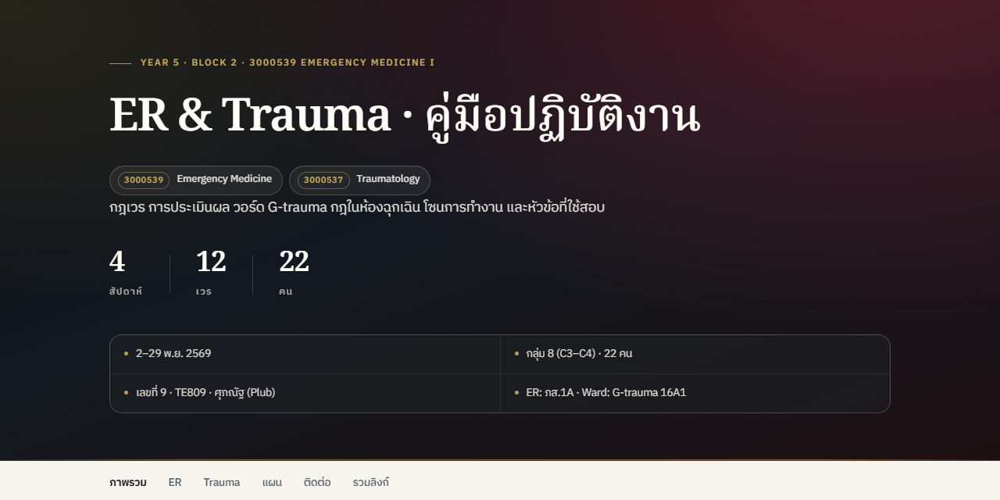

<div align="center">
  
  <h1>ER &amp; Trauma 2569</h1>
  <p><strong>คู่มือปฏิบัติงานบล็อค ER &amp; Trauma</strong> — ตารางเวร เกณฑ์ประเมิน หัตถการ และ checklist ในหน้าเดียว</p>
  <p>
    <a href="https://plub-supanut.github.io/mdcu-er-trauma-2569/"></a>
    <a href="https://github.com/Plub-Supanut/mdcu-er-trauma-2569/commits/main"></a>
    
  </p>
  <p>
    <a href="https://plub-supanut.github.io/mdcu-er-trauma-2569/"><strong>เปิดเว็บ</strong></a>
    &nbsp;·&nbsp;
    <a href="ER-Trauma-2569.pdf">PDF</a>
    &nbsp;·&nbsp;
    <a href="https://github.com/Plub-Supanut/plub-standard/blob/main/GITHUB_STANDARD.md">Project standard</a>
    &nbsp;·&nbsp;
    <a href="https://github.com/Plub-Supanut/mdcu-er-trauma-2569">GitHub</a>
  </p>
</div>

---

## Overview

คู่มือรายวิชา **3000539 Emergency Medicine I** และ **3000537 Traumatology** บล็อค ER & Trauma (2–29 พ.ย. 2569) ของกลุ่ม 8 (C3–C4) — รวมข้อมูลที่ต้องใช้จริงระหว่างบล็อคไว้หน้าเดียว เปิดจากมือถือได้ทันที

## What's inside

- **ภาพรวม 2 วิชา** — รหัสวิชา การประเมิน และรายละเอียดที่ต้องรู้
- **ภาค ก · ER** — ตารางเวร กฎในห้องฉุกเฉิน โซน IPC และหัวข้อที่ใช้สอบ
- **ภาค ข · G-trauma 16A1** — เวลาราวน์ การรับเคส ตารางสอน และเกณฑ์ประเมิน
- **ภาค ค · แผนทบทวน** — ตารางทบทวนและช่วงก่อนสอบ
- **Checklist** — งานที่ต้องส่งและช่องทางติดต่อ

## Screenshot


## Quick start

เปิดเว็บ: **https://plub-supanut.github.io/mdcu-er-trauma-2569/**

หรือดาวน์โหลด [ER-Trauma-2569.pdf](ER-Trauma-2569.pdf) ไปเปิด/พิมพ์ได้เลย

## Print / PDF

กดปุ่มพิมพ์มุมขวาล่าง หรือ `Ctrl + P` / `Cmd + P` — เลือก A4 (เปิด Background graphics ถ้าต้องการพื้นหลังครบ)
ไฟล์ PDF ที่แนบมาใช้ได้เลยไม่ต้องพิมพ์เอง

## Project structure

```text
index.html          หน้าเว็บทั้งหมด (HTML + CSS + JS)
ER-Trauma-2569.pdf  PDF สำหรับพิมพ์/แชร์
docs/preview.png    ภาพ preview
.nojekyll           ปิด Jekyll บน GitHub Pages
README.md           ไฟล์นี้
```

## Development

```bash
git clone https://github.com/Plub-Supanut/mdcu-er-trauma-2569.git
cd mdcu-er-trauma-2569
python -m http.server 8080
# เปิด http://127.0.0.1:8080
```

ไม่มี dependency/build — แก้ `index.html` แล้ว commit ได้เลย
ก่อน commit ตรวจ 3 อย่าง: สารบัญเลื่อนตามหัวข้อได้ · ปุ่มพิมพ์เปิด dialog · ธีมมืดอ่านง่าย

## Notes

- เนื้อหารวบรวมจากประกาศและคู่มือรายวิชา ใช้ประกอบการเรียนเท่านั้น ไม่ใช่เอกสารทางการของคณะหรือโรงพยาบาล
- ตารางเวร/กำหนดการอาจเปลี่ยน — ยึดประกาศล่าสุดของภาควิชา
- ไม่มีข้อมูลผู้ป่วยหรือข้อมูลระบุตัวตน

## Standard

โปรเจกต์นี้ทำตาม [Plub-Supanut Project Standard](https://github.com/Plub-Supanut/plub-standard/blob/main/GITHUB_STANDARD.md)

## License

เนื้อหาและโค้ด © 2026 Plub-Supanut — ใช้เพื่อการศึกษา
